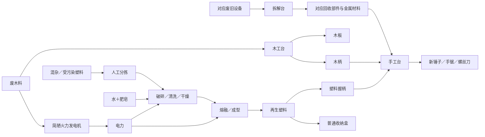

# 首批产线与科技

来源：S1 第十六节、S2、S3。下表表达关系，不是可执行的定量配方。材料数量、产量、耗时、岗位、完整工具列表、电耗、占地和残余物均待补齐。

## 原料与加工

| 产线 | 输入 → 工序 → 输出 | 工作地点与注意事项 |
|---|---|---|
| 木工 | 废木料 → 挑选、去连接件、锯切 → 木板／木柄 | 手工木工台；木板与木柄是否独立配方未定，切割用手锯 |
| 设备回收 | 对应前期废旧设备 → 拆卸、分类、挑选 → 对应部件／金属材料／金属零件 | 拆解台；产出依设备而定，不保证每台设备产出全部部件；螺钉用螺丝刀，螺母螺栓用扳手 |
| 工具装配 | 回收锤头／锯片／螺丝刀金属杆 ＋ 木柄或塑料握柄 → 新工具 | 手工台；三类工具各有两种柄版本；扳手、针线没有已确认制造流程 |
| 修补布料 | 废旧纺织品 → 裁剪 → 修补布料 | 地点、工具及是否预先清洗未定；也可购买 |
| 衣物 | 废旧衣服 ＋ 水 ＋ 肥皂 → 清洗；再用修补布料和针线工具修补 → 可穿衣服 | 清洗点＋手工台；不新增未确认的中间库存名 |
| 抹布 | 废旧纺织品 ＋ 水 ＋ 肥皂 → 清洗、裁剪 → 抹布 | 清洗点＋手工台；裁剪工具未定 |
| 抹布再用 | 使用后的抹布 ＋ 水 ＋ 肥皂 → 清洗 → 可继续使用的抹布 | 清洗点；使用后状态是否独立库存未定 |
| 扫帚 | 木柄 ＋ 回收扫帚头 → 装配 → 扫帚 | 手工台；不补塑料柄扫帚配方 |
| 塑料分拣 | 混杂／受污染塑料 → 区分塑料、去混入物 → 已分拣塑料 | 独立分拣地点，纯人工，不耗电；类型与不可利用部分待定 |
| 塑料预处理 | 已分拣塑料 ＋ 少量水、肥皂 → 破碎、清洗、干燥 → 清洁塑料碎片 | 独立预处理设备，工人＋电力；保护饮水保留量 |
| 塑料再加工 | 清洁塑料碎片 → 熔融、成型 → 再生塑料 | 工人＋电力 |
| 塑料成品 | 再生塑料 → 塑料握柄或普通收纳盒 | 同一个再加工地点切换配方，仍需工人＋电力；收纳盒仅确认可售 |
| 发电 | 废木料 → 燃烧 → 电力 | 简陋火力发电机；不推定生成灰渣或支持其他燃料 |
| 损坏工具回收 | 损坏工具 → 拆解 → 部分普通材料 | S3 的补充，其他原文仍标待定；具体材料不命名，不返还完整工具部件；工程暂不执行 |

图中再生塑料、握柄、收纳盒由同一地点生产；图形分开仅为表达投入产物关系，不增加工作地点。回收部件箭头不是完整掉落表。

## 设施建造

| 设施 | 已确认建造材料 | 人工与能源 |
|---|---|---|
| 最简易木工台 | 废木料、回收连接件 | 人工加工 |
| 最简易拆解台 | 废木料、回收连接件 | 人工拆解 |
| 手工台 | 木板、金属零件 | 人工装配／修补／裁剪 |
| 生活用品清洗点 | 木板、金属零件、回收容器 | 人工；清洗消耗水与肥皂 |
| 塑料分拣地点 | 木板、金属零件 | 人工，无电力需求 |
| 塑料预处理设备 | 回收电机、金属零件、回收容器、导线 | 工人＋电力 |
| 塑料再加工设备 | 金属零件、回收加热部件、导线、对应模具 | 工人＋电力 |
| 简陋火力发电机 | 回收热力驱动部件、发电部件、导线、金属零件 | 主角组装；补料后自行发电 |
| 电动木工设备 | 回收电机、对应锯片、木板、金属零件 | 工人操作，电力切割 |
| 自动木工设备 | 在电动设备基础上追加材料，具体未定 | 自动进料、切割、出料；上游分拣仍人工 |
| 仓库／传送带／供电线路 | 建造配方未定 | 不视为免费建设；传送带少量耗电 |

模具在初版再加工设备建造时配置；切换配方不额外消耗、不磨损。具体产品对应何种模具待定，不默认一副模具通用所有成品。

## 科技与成长

| 首次取得物品 | 自动解锁 |
|---|---|
| 回收电机 | 电动木工、塑料预处理 |
| 回收加热部件 | 塑料再加工 |

取得原料即解锁，不消耗原料、不花研究时间。建造设备仍消耗完整材料组合。自动木工不随回收电机自动解锁。

木工成长：手工锯切 → 电动切割但工人操作 → 传送带运输 → 自动进料、切割和出料。原手工设备可保留。塑料后续技术减少人工但仍处理较慢，具体升级未确认。

## 供应与工具

食物、水来自购买或垃圾中未开封物资；衣服来自购买或回收清洗修补；扫帚、肥皂、抹布按已确认流程购买／取得／加工。居民自动从仓库领用。衣服、扫帚磨损，肥皂消耗，抹布可洗后再用。食物与水不足影响人工效率，长期可致死亡；具体数值和判定未定。

木柄／塑料柄工具用于新工具装配，旧工具不换柄。塑料柄只提升相关人工工序。S3 更进一步规定作业量扣耐久、木柄更耐用、损坏工具回收等；这些内容与 S1 / S2 的待定状态保留为差异，工程不预设最终耐久参数。
